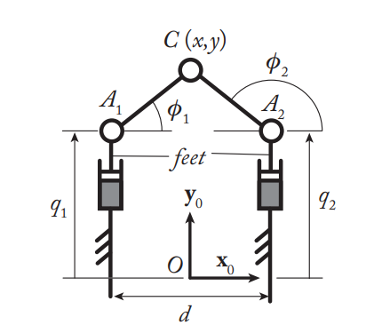
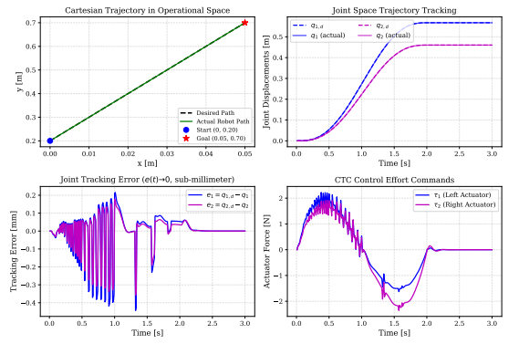

# Biglide Parallel Robot – Modelling and Computed Torque Control (ROS 2 / Gazebo)

Geometric, kinematic and dynamic models of a 2-DOF **Biglide** parallel robot, validated against a Gazebo simulation, and used to drive the robot with a **Computed Torque Controller (CTC)**.

M2 IMARO lab project (AMORO course), École Centrale de Nantes, 2026.
Authors: **Sriram Pandian** and **Hussein Elnaggar**.



## What the project does

- Derives every model of the Biglide by hand: direct and inverse geometric models, first- and second-order kinematic models, and the inverse dynamic model.
- Implements them in Python and checks each one against Gazebo ground truth, using ROS 2 co-simulation.
- Plans a 5th-order polynomial trajectory and tracks it with a Computed Torque Controller.
- Studies Type 2 (parallel) singularities and shows how to design a trajectory that crosses one with bounded actuator forces.

## Results

**All models match Gazebo** (mean absolute error over 6,000 samples):

| Model | Mean error |
| --- | --- |
| Direct geometric model (x, y) | < 3 × 10⁻⁶ m |
| Inverse geometric model (q1, q2) | ≈ 3 × 10⁻⁶ m |
| First-order kinematic models | < 6 × 10⁻⁶ m/s |
| Second-order kinematic models | < 3 × 10⁻⁴ m/s² |
| Inverse dynamic model (τ1, τ2) | < 4 × 10⁻⁴ N |

**Computed Torque Control** (ωn = 20 rad/s, ζ = 1):

- Mean joint tracking error: about 0.06 mm. Maximum error: below 0.44 mm.
- Peak actuator force: about 2.4 N.
- Recovers from a 30 mm initial offset in about 0.3 s.
- Gain study (ωn = 5, 10, 20, 40 rad/s): ωn = 20 gives the best trade-off. At ωn = 40, the 10 ms sampling causes chattering.



## Repository structure

```
biglide_models.py        # DGM, IGM, kinematic models (1st and 2nd order), inverse dynamic model
model_test.py            # Live plots: direct models vs Gazebo
inverse_model_test.py    # Live plots: inverse models vs Gazebo
model_eval.py            # 60 s automatic validation, prints mean error per model
control.py               # Trajectory planning + Computed Torque Control
singularity_control.py   # Type 2 singularity crossing study
reports/                 # Model derivation and full lab report (PDF)
figures/                 # Plots used in this README
```

## How to run

Requirements: ROS 2, Gazebo, Python 3, NumPy, and the `lab_amoro` package from the AMORO course. The course package is not included in this repository.

```bash
python3 model_eval.py              # validate all models against Gazebo
python3 control.py                 # run the Computed Torque Controller
python3 singularity_control.py     # offline singularity study
```

## Key equations

Kinematic constraint: `A_r · ξ̇ + B · q̇_a = 0`, with direct Jacobian `J = −A_r⁻¹ B`

Dynamic model: `τ = M(q) · q̈_a + c(q, q̇)`, with `M = m_f·I + m_p·Jᵀ J`

Control law: `τ = M · (q̈_d + K_d·ė + K_p·e) + c`

Full derivations are in [`reports/Biglide_Model.pdf`](reports/Biglide_Model.pdf).

## What I learned

A single wrong sign convention, assembly mode or transposed Jacobian shows up immediately as curves that don't overlap in the simulator. Finding and fixing these taught us exactly how a theoretical model maps onto a real robot's joint conventions.

## Skills

Parallel robot kinematics · Dynamic modelling · Computed Torque Control · Trajectory planning · Singularity analysis · Python / NumPy · ROS 2 · Gazebo
